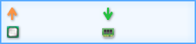
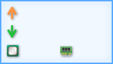

**Tiếng Việt** · [Trang chủ](./README.md) · [Hỏi đáp](./Help.md) · [Tự làm skin](./HuongDanTaoSkin.md)

# Kho giao diện (skin) — TrafficMonitor-VN

Trang này được mở từ liên kết **Tải thêm mẫu mạng** trong hộp thoại **Kho Giao diện (Skin)**.

## Skin có sẵn trong bản phát hành

Mọi bản phát hành của TrafficMonitor-VN kèm sẵn các skin dưới đây trong thư mục `skins` cạnh `TrafficMonitor.exe`. Ảnh dưới đây là ảnh nền chế độ hiện thêm thông số (`background_l`); chữ và số do chương trình vẽ lên khi chạy.

| Tên thư mục | Ảnh nền | Ghi chú |
|---|---|---|
| `0_tsudev_Cu` |  | **Skin mặc định** — chú cú tsudev, nền sáng |
| `tsudev_VongMang` |  | Biểu tượng tsudev, nền tối |
| `GiaoDien03` |  | Nền tối |
| `GiaoDien05` |  | |
| `GiaoDien06` |  | Nền tối |
| `GiaoDien08` |  | Nền tối |
| `GiaoDien09` |  | |
| `GiaoDien10` |  | Dạng biểu tượng, gọn |
| `GiaoDien10_Doc` |  | Dạng dọc |
| `GiaoDien11` |  | Ô màu CPU/RAM |

Hai skin `0_tsudev_Cu` và `tsudev_VongMang` do tsudev thiết kế (nguồn ảnh và script sinh ở `tools/skin_assets/`). Các skin `GiaoDien*` kế thừa từ dự án gốc TrafficMonitor (tác giả zhongyang219, xem [NOTICE.md](./NOTICE.md)). Từ V1.90-vn, bốn skin có hình nhân vật hoạt hình của bên thứ ba (`0_MacDinh`, `MacDinh2`, `GiaoDien01`, `GiaoDien02`) không còn kèm theo; máy đang dùng các skin này sẽ tự chuyển sang `0_tsudev_Cu`.

## Cài thêm skin

1. Mỗi skin là **một thư mục** gồm `skin.xml` hoặc `skin.ini` và ảnh nền `background.bmp`/`background.png` (cửa sổ thường) và `background_l.bmp`/`background_l.png` (khi hiện thêm thông số).
2. Chép cả thư mục skin vào thư mục `skins` cạnh `TrafficMonitor.exe`.
3. Mở menu chuột phải → **Chức năng khác** → **Đổi giao diện...**, chọn skin vừa chép rồi bấm **OK**.

> ⚠️ Skin chỉ chứa ảnh và tệp cấu hình văn bản, không chứa mã chạy được. Dù vậy, chỉ tải skin từ nguồn bạn tin cậy và không chạy tệp `.exe`/`.bat` đi kèm gói skin.

## Tự làm skin

Xem [Hướng dẫn tạo skin](./HuongDanTaoSkin.md): bố cục, toạ độ từng mục, màu chữ, ảnh nền PNG trong suốt và cách thử nghiệm.

## Đóng góp skin

Bạn có skin muốn chia sẻ? Mở [Issue](https://github.com/tsudev-tsudev/tsudev-trafficmonitor/issues) hoặc Pull Request thêm thư mục skin vào `TrafficMonitor/skins` kèm:

* ảnh nền do bạn tự thiết kế hoặc có quyền phân phối lại (không dùng logo, nhân vật, hình ảnh có bản quyền của bên thứ ba);
* tên tác giả trong `skin_author` của tệp cấu hình;
* đồng ý phát hành theo giấy phép của dự án ([LICENSE](./LICENSE)).
