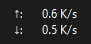
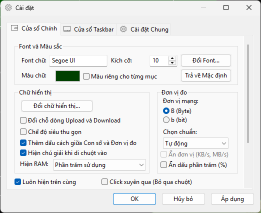
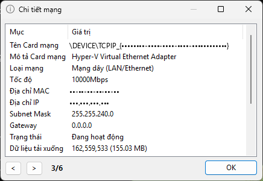

**Tiếng Việt | [English](./README_en-us.md)**

[](https://github.com/tsudev-org/tsudev-trafficmonitor/actions/workflows/build.yml)
[](https://github.com/tsudev-org/tsudev-trafficmonitor/actions/workflows/codeql.yml)
[](https://github.com/tsudev-org/tsudev-trafficmonitor/releases/latest)
[](./LICENSE)


# tsudev-trafficmonitor

Theo dõi tốc độ mạng, CPU, RAM trên Windows - bản Việt hóa và gia cố bảo mật của TrafficMonitor.

Một sản phẩm của [tsudev](https://tsudev.com). Trang sản phẩm: [trafficmonitor.tsudev.com](https://trafficmonitor.tsudev.com). Hạng sản phẩm **C** (chạy ngoại tuyến, không tài khoản; mạng chỉ dùng để kiểm tra bản cập nhật và tra IP công cộng khi người dùng bấm).

**tsudev-trafficmonitor** là bản Việt hóa và gia cố bảo mật của TrafficMonitor - phần mềm giám sát tốc độ mạng, mức sử dụng CPU/RAM/GPU/ổ cứng trên Windows với cửa sổ nổi và hiển thị trực tiếp trên thanh tác vụ (Taskbar).

## Điểm khác biệt so với bản gốc

### Việt hóa
* **Giao diện tiếng Việt mặc định** ngay lần chạy đầu tiên (vẫn chọn được ngôn ngữ khác hoặc “Theo hệ thống” trong **Cài đặt Chung**).
* Gói ngôn ngữ tiếng Việt **đầy đủ 100%** chuỗi giao diện, được **nhúng sẵn** trong tệp chương trình (không cần thư mục `language`).
* Hộp thoại chọn màu, plugin mẫu, tài liệu Hỏi đáp, hướng dẫn tạo skin, mẫu báo lỗi... đều bằng tiếng Việt.
* Toàn bộ chú thích mã nguồn (≈2.800 đoạn trong 186 tệp) được dịch sang tiếng Việt, thuận tiện cho lập trình viên Việt Nam phát triển tiếp.

### Bảo mật
| Hạng mục | Bản gốc | tsudev-trafficmonitor |
|---|---|---|
| Nguồn cập nhật | GitHub hoặc Gitee | Chỉ repo tsudev-trafficmonitor trên GitHub |
| Kiểm tra liên kết tải bản cập nhật | Chấp nhận mọi đường dẫn `github.com/`, `gitee.com/` | Chỉ chấp nhận trang Releases của repo này, chặn `..`, `@`, `?`, `#`, `%`, chỉ `.zip`/`.exe` |
| Tải bản cập nhật | Mở trình duyệt, không kiểm tệp tải về | Thông tin phiên bản có **chữ ký số** (ECDSA P-256); ứng dụng tự tải gói và chỉ lưu khi **SHA-256 khớp** giá trị đã ký |
| So sánh phiên bản | So sánh chuỗi (sai khi `1.100` vs `1.86`) | So sánh theo số |
| Giao thức tải dữ liệu | Mọi giao thức `OpenURL` hỗ trợ (kể cả `file://`, `ftp://`) | **Chỉ HTTPS**, có timeout, giới hạn 1 MB, không cache/cookie |
| Tra cứu IP công cộng | Dịch vụ bên thứ ba ở nước ngoài, có gửi vị trí | [ipify](https://www.ipify.org/) (mã nguồn mở, chỉ trả IP), chỉ khi người dùng bấm |
| Nạp DLL / plugin | Thứ tự tìm DLL mặc định | Chống DLL hijacking (`SetDefaultDllDirectories`, `LoadLibraryEx` an toàn) |
| Cờ biên dịch | Mặc định | `/guard:cf`, `/sdl`, `/GS`, ASLR, DEP, CET Shadow Stack |
| CI/CD | Build khi gắn tag | Build mỗi lần push/PR, CodeQL quét lỗ hổng, Dependabot, SHA-256 cho bản phát hành |

Chi tiết xem [SECURITY.md](./SECURITY.md).

## Tải về

* Bản phát hành: [trang Tải về](https://trafficmonitor.tsudev.com/tai-ve/) hoặc [Releases](https://github.com/tsudev-org/tsudev-trafficmonitor/releases/latest). Mỗi bản phát hành kèm tệp `SHA256SUMS.txt` và chứng thực nguồn gốc build - hãy đối chiếu mã băm trước khi chạy (xem [SECURITY.md](./SECURITY.md#kiểm-tra-tính-toàn-vẹn-tệp-tải-về)).
* Gói phát hành là tệp `.zip` giải nén là chạy (`tsudev-trafficmonitor_<phiên bản>_<kiến trúc>_Lite.zip`), không có bộ cài `-setup.exe` như mẫu tên trong chuẩn VERSIONING của tsudev; kiến trúc là `x64`, `x86` hoặc `arm64ec` (ghi đúng kiểu build ARM64EC thay cho `arm64`).
* Kiểm tra cập nhật trong ứng dụng chỉ tin thông tin phiên bản có **chữ ký số** (ECDSA P-256). Từ 26.11.0905, khi bạn bấm **Có**, ứng dụng tự tải gói, kiểm SHA-256 với giá trị đã ký, lưu vào thư mục Tải về (không ghi đè tệp có sẵn) và mở thư mục chọn sẵn tệp; SHA-256 lệch thì xóa tệp và báo lỗi. Ứng dụng không tự giải nén hay tự chạy gói.
* Bản build thử nghiệm: tab [Actions](https://github.com/tsudev-org/tsudev-trafficmonitor/actions/workflows/build.yml) (cần đăng nhập GitHub).

tsudev-trafficmonitor **chỉ** được phát hành qua repo GitHub trên. Mọi trang web khác tự xưng là “trang chính thức” đều không liên quan.

Chương trình cần **Microsoft Visual C++ Redistributable**. Nếu khi chạy báo thiếu `MSVC*.dll`/`mfc*.dll`, hãy cài từ trang của Microsoft: [Latest supported Visual C++ Redistributable](https://learn.microsoft.com/cpp/windows/latest-supported-vc-redist).

## Phiên bản

tsudev-trafficmonitor phát hành bản **Lite** (không cần quyền Quản trị viên). Bản Lite có giám sát GPU và ổ cứng, nhưng **không đo nhiệt độ**.

| Tính năng | Bản đầy đủ (tự build) | Bản Lite |
|---|---|---|
| Tốc độ mạng | ✔ | ✔ |
| Mức dùng CPU, RAM | ✔ | ✔ |
| Tần số CPU, mức dùng GPU, ổ cứng | ✔ | ✔ |
| Nhiệt độ CPU/GPU/ổ cứng/bo mạch chủ | ✔ | ❌ |
| Chi tiết kết nối mạng, thống kê lưu lượng | ✔ | ✔ |
| Skin, plugin | ✔ | ✔ |
| Cần quyền Quản trị viên | Có | Không |

## Tính năng chính

* Hiển thị tốc độ tải lên/tải xuống, mức sử dụng CPU và bộ nhớ.
* Tự động hoặc chọn thủ công card mạng khi máy có nhiều kết nối.
* Xem chi tiết kết nối mạng.
* Hiển thị nhúng trên thanh tác vụ (hỗ trợ Windows 11, nhiều màn hình).
* Đổi skin ([kho giao diện](./KhoGiaoDien.md)), tự tạo skin ([hướng dẫn](./HuongDanTaoSkin.md)).
* Thống kê lưu lượng theo ngày/tuần/tháng/quý/năm.
* Hệ thống plugin.

## Cách sử dụng

Khi khởi động, một **cửa sổ nổi** hiển thị tốc độ mạng xuất hiện trên màn hình. Nhấp chuột phải vào cửa sổ để mở menu.

* **Hiển thị trên thanh tác vụ:** menu chuột phải → **Hiện ở dưới Taskbar**.
* **Chọn mục hiển thị trên thanh tác vụ:** nhấp chuột phải vào cửa sổ Taskbar → **Sắp xếp hiển thị...**.
* **Hiện CPU/RAM trên cửa sổ nổi:** menu chuột phải → **Hiện thêm thông số**.
* **Đổi skin:** menu chuột phải → **Chức năng khác** → **Đổi giao diện...**.
* **Tùy chọn:** menu chuột phải → **Cài đặt...** (màu chữ, phông chữ, đơn vị tốc độ, cảnh báo lưu lượng, tự khởi động...).

Gặp sự cố? Xem [Câu hỏi thường gặp](./Help.md).

## Ảnh chụp màn hình

Cửa sổ nổi (skin mặc định):


Cửa sổ trên thanh tác vụ (Windows 11):



Cài đặt:



Chi tiết mạng (nhấp đúp vào cửa sổ nổi; địa chỉ MAC, IP và tên card trong ảnh đã được che):



## Plugin

Plugin là tệp `.dll` đặt trong thư mục `plugins` cạnh `tsudev-trafficmonitor.exe`, được nạp khi chương trình khởi động; quản lý tại **Cài đặt Chung** → **Nâng cao** → **Quản lý Plugin...**.

* Cài plugin: [Plugin](./Plugin.md).
* Phát triển plugin: [Phát triển plugin](./PhatTrienPlugin.md); giao diện lập trình (đã chú thích tiếng Việt) ở [`include/PluginInterface.h`](./include/PluginInterface.h), ví dụ ở [`PluginDemo`](./PluginDemo).

> ⚠️ Plugin chạy **cùng quyền với tsudev-trafficmonitor**. Chỉ cài plugin từ nguồn tin cậy.

## Giám sát phần cứng

Tính năng đo nhiệt độ (chỉ có ở bản đầy đủ) dựa trên thư viện [LibreHardwareMonitor](https://github.com/LibreHardwareMonitor/LibreHardwareMonitor) và **tắt theo mặc định**. Bật tại **Cài đặt Chung** → **Theo dõi Phần cứng**.

**Lưu ý:** tính năng này có thể làm tăng mức dùng CPU/RAM; một số máy gặp lỗi đóng chương trình đột ngột hoặc treo máy. Chỉ bật khi bạn chấp nhận các rủi ro này.

## Build từ mã nguồn

Yêu cầu: Windows 10/11, **Visual Studio 2022** với workload *Desktop development with C++*, thành phần **C++ MFC for latest v143 build tools** (x86 & x64, và ARM64EC nếu cần), cùng **.NET Framework 4.7.2 targeting pack** (cho bản đầy đủ).

```bat
:: Bản Lite (khuyến nghị)
msbuild tsudev-trafficmonitor_Lite.sln -p:Configuration="Release (lite)" -p:Platform=x64

:: Bản đầy đủ (có đo nhiệt độ)
msbuild tsudev-trafficmonitor.sln -p:Configuration=Release -p:Platform=x64
```

Tệp kết quả nằm trong `Bin\x64\Release (lite)\` (hoặc `Bin\x64\Release\`).

Cấu hình riêng của bản Việt hóa (repo, URL cập nhật, ngôn ngữ mặc định) tập trung tại [`tsudev-trafficmonitor/ForkConfig.h`](./tsudev-trafficmonitor/ForkConfig.h). Cờ biên dịch bảo mật nằm ở [`Directory.Build.props`](./Directory.Build.props).

### Phát hành (người bảo trì)

1. Cập nhật số phiên bản `{YY}.{M}.{DD}{NN}` ở `VERSION` (`tsudev-trafficmonitor/stdafx.h`), VERSIONINFO trong `tsudev-trafficmonitor/tsudev-trafficmonitor.rc` và `version_utf8.info`.
2. Thêm một dòng vào [CHANGELOG.md](./CHANGELOG.md) và phần chi tiết vào `UpdateLog/update_log_vi.md` + `UpdateLog/update_log_en-us.md`.
3. PR → CI đạt → gộp; gắn tag có chữ ký `V<phiên bản>-vn`; duyệt environment `release`; kiểm SHA-256, chứng thực build và chữ ký `version_signed.xml`; deploy website.

Khóa bí mật ký thông tin cập nhật chỉ nằm trong secret `UPDATE_SIGNING_KEY` của environment `release` (chủ repo tsudev giữ; người bảo trì khác xin quyền duyệt environment qua chủ repo). Khóa công khai: `tools/keys/update_signing_pub.pem`.

Khi đổi khóa ký: thay `FORK_UPDATE_PUBLIC_KEY_HEX` (ForkConfig.h), `tools/keys/update_signing_pub.pem` và dữ liệu mẫu `tests/fixtures/version_signed.xml(.sig)` bằng manifest ký bằng khóa mới, nếu không job "Kiểm thử C++" sẽ báo lỗi.

### Lịch sử mã nguồn

Repo này bắt đầu bằng một commit nhập mã nguồn từ bản V1.87-vn; đây là nơi duy nhất chứa mã nguồn, bản phát hành và kênh cập nhật của tsudev-trafficmonitor. Các thay đổi trước đó (V1.86-vn, V1.87-vn) tóm tắt trong [CHANGELOG.md](./CHANGELOG.md); nguồn gốc mã và giấy phép xem [NOTICE.md](./NOTICE.md). Repo cũ `tsudev-tsudev/tsudev-trafficmonitor` đã được gỡ (11/2026).

## Đóng góp

* Báo lỗi / đề xuất: [Issues](https://github.com/tsudev-org/tsudev-trafficmonitor/issues/new/choose).
* Lỗ hổng bảo mật: **không** đăng công khai, xem [SECURITY.md](./SECURITY.md).
* Nhật ký thay đổi: [CHANGELOG.md](./CHANGELOG.md) (mỗi bản một dòng), chi tiết ở [UpdateLog/update_log_vi.md](./UpdateLog/update_log_vi.md).

## Giấy phép

Phát hành theo giấy phép **"Anti 996" License 1.0** - xem [LICENSE](./LICENSE) (bản tiếng Anh) và [LICENSE_CN](./LICENSE_CN) (bản tiếng Trung). Bản dịch tiếng Việt chỉ để tham khảo: [LICENSE_VI.md](./LICENSE_VI.md).

Copyright (c) 2026 tsudev. Thông báo bản quyền của dự án gốc (bắt buộc giữ theo điều 1 của giấy phép) nằm trong [LICENSE](./LICENSE) và [NOTICE.md](./NOTICE.md).
