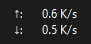
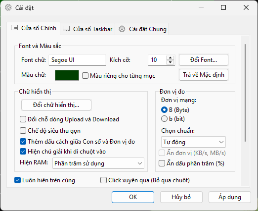
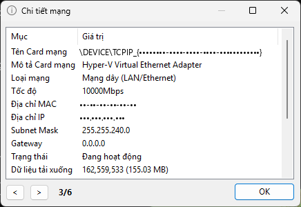

**[Tiếng Việt](./README.md) | English**

[](https://github.com/tsudev-org/tsudev-trafficmonitor/actions/workflows/build.yml)
[](https://github.com/tsudev-org/tsudev-trafficmonitor/actions/workflows/codeql.yml)
[](https://github.com/tsudev-org/tsudev-trafficmonitor/releases/latest)
[](./LICENSE)


# tsudev-trafficmonitor

Network speed, CPU and RAM monitor for Windows - the Vietnamese-localized, security-hardened edition of tsudev-trafficmonitor.

A [tsudev](https://tsudev.com) product. Product page: [trafficmonitor.tsudev.com](https://trafficmonitor.tsudev.com). Product class **C** (works offline, no account; the network is used only to check for updates and to look up your public IP when you ask for it).

**tsudev-trafficmonitor** monitors network speed and CPU/RAM/GPU/disk usage on Windows, with a floating window and an embedded display on the taskbar.

## What is different

### Localization
* **Vietnamese UI by default** on first run (you can still pick another language or "Follow system" in **General Settings**). The English UI is fully supported.
* The Vietnamese language pack covers **100%** of UI strings and is **embedded** in the executable (no `language` folder needed).
* Source code comments (≈2,800 blocks in 186 files) are in Vietnamese.

### Security
| Area | Original | tsudev-trafficmonitor |
|---|---|---|
| Update source | GitHub or Gitee | Only the tsudev-trafficmonitor repository on GitHub |
| Update information | Unsigned | **Signed** (ECDSA P-256, verified with Windows CNG); the app downloads the package itself and keeps it only if its **SHA-256 matches** the signed value |
| Download link validation | Any `github.com/`, `gitee.com/` path | Only this repository's Releases page; rejects `..`, `@`, `?`, `#`, `%`; `.zip`/`.exe` only |
| Version comparison | String comparison (wrong for `1.100` vs `1.86`) | Numeric |
| Network protocol | Anything `OpenURL` supports (including `file://`, `ftp://`) | **HTTPS only**, timeout, 1 MB limit, no cache/cookies, allowed hosts only |
| Public IP lookup | Third-party service that also returns location | [ipify](https://www.ipify.org/) (open source, returns only the IP), only on demand |
| DLL / plugin loading | Default DLL search order | DLL hijacking protection (`SetDefaultDllDirectories`, safe `LoadLibraryEx`) |
| Compiler flags | Defaults | `/guard:cf`, `/sdl`, `/GS`, ASLR, DEP, CET Shadow Stack |
| CI/CD | Build on tag | Build on every push/PR, CodeQL, Dependabot, SHA-256 and build provenance attestation for releases |

Details: [SECURITY.md](./SECURITY.md) (Vietnamese).

## Download

* Releases: [Download page](https://trafficmonitor.tsudev.com/tai-ve/) or [GitHub Releases](https://github.com/tsudev-org/tsudev-trafficmonitor/releases/latest). Each release includes `SHA256SUMS.txt` and a GitHub build provenance attestation - check the hash before running.
* Packages are ready-to-run `.zip` files (`tsudev-trafficmonitor_<version>_<arch>_Lite.zip`); there is no `-setup.exe` installer as in tsudev's VERSIONING naming template, and the architecture is `x64`, `x86` or `arm64ec` (named after the actual ARM64EC build instead of `arm64`).
* The in-app update check only trusts **signed** version information. From 26.11.0905, when you click **Yes**, the app downloads the package, checks its SHA-256 against the signed value, saves it to your Downloads folder (never overwriting an existing file) and opens the folder with the file selected; on a SHA-256 mismatch the file is deleted and an error is shown. The app never extracts or runs the package.
* CI test builds: [Actions](https://github.com/tsudev-org/tsudev-trafficmonitor/actions/workflows/build.yml) (GitHub sign-in required).

tsudev-trafficmonitor is published **only** through the GitHub repository above and trafficmonitor.tsudev.com. Any other site claiming to be "official" is unrelated.

The program needs the **Microsoft Visual C++ Redistributable**. If it reports a missing `MSVC*.dll`/`mfc*.dll`, install the [latest supported Visual C++ Redistributable](https://learn.microsoft.com/cpp/windows/latest-supported-vc-redist).

## Editions

tsudev-trafficmonitor releases the **Lite** edition (no administrator rights needed). Lite monitors GPU and disk usage but **does not measure temperatures**.

| Feature | Full edition (build it yourself) | Lite |
|---|---|---|
| Network speed | ✔ | ✔ |
| CPU and RAM usage | ✔ | ✔ |
| CPU frequency, GPU and disk usage | ✔ | ✔ |
| CPU/GPU/disk/motherboard temperature | ✔ | ❌ |
| Connection details, traffic statistics | ✔ | ✔ |
| Skins, plugins | ✔ | ✔ |
| Administrator rights required | Yes | No |

## Main features

* Shows upload/download speed, CPU and memory usage.
* Selects the network adapter automatically or manually when there are several connections.
* Shows network connection details.
* Embedded display on the taskbar (Windows 11 and multiple monitors supported).
* Changeable skins ([skin gallery](./SkinGallery_en-us.md)) and custom skins ([tutorial](./SkinTutorial_en-us.md)).
* Traffic statistics by day/week/month/quarter/year.
* Plugin system.

## How to use

When the program starts, a **floating window** showing the network speed appears on the screen. Right-click it to open the menu.

* **Show on the taskbar:** right-click menu → **Show Taskbar Window**.
* **Choose what the taskbar window shows:** right-click the taskbar window → **Display Settings...**.
* **Show CPU/RAM in the floating window:** right-click menu → **Show More Info**.
* **Change skin:** right-click menu → **Other Functions** → **Change Skin...**.
* **Options:** right-click menu → **Options...** (text color, font, speed unit, traffic alerts, auto run...).

Having problems? See the [FAQ](./Help_en-us.md).

## Screenshots

The screenshots show the Vietnamese UI; with English selected, the same windows use the English labels above.

Floating window (default skin):


Taskbar window (Windows 11):



Options:



Connection details (double-click the floating window; MAC address, IP and adapter name are masked):



## Skins

Skins live in the `skins` folder next to `tsudev-trafficmonitor.exe`, one folder per skin (the folder name is the skin name). A skin consists of background images (`background.png`/`background_l.png` with transparency, or `.bmp`) and a configuration file `skin.xml` (or the older `skin.ini`) that sets text colors, fonts, the author, and the size and position of each item. Without `skin.xml`, temperatures and GPU usage cannot be shown.

* Browse the included skins: [Skin gallery](./SkinGallery_en-us.md).
* Make your own: [Skin tutorial](./SkinTutorial_en-us.md).

## Plugins

Plugins are `.dll` files placed in the `plugins` folder next to `tsudev-trafficmonitor.exe` and loaded at startup; manage them in **General Settings** → **Advanced** → **Plug-in manage...**.

* Installing plugins: [Plugins](./Plugin_en-us.md).
* Writing plugins: [Plugin development](./PluginDev_en-us.md); the API (with Vietnamese comments) is [`include/PluginInterface.h`](./include/PluginInterface.h), with an example in [`PluginDemo`](./PluginDemo).

> ⚠️ Plugins run **with the same rights as tsudev-trafficmonitor**. Only install plugins from sources you trust.

## Hardware monitoring

Temperature monitoring (full edition only) uses the [LibreHardwareMonitor](https://github.com/LibreHardwareMonitor/LibreHardwareMonitor) library and is **off by default**. Turn it on in **General Settings** → **Hardware Monitoring**.

**Note:** this feature can increase CPU/RAM usage; on some machines it has caused crashes or system hangs. Only turn it on if you accept these risks.

## Building from source

Requirements: Windows 10/11, **Visual Studio 2022** with the *Desktop development with C++* workload, the **C++ MFC for latest v143 build tools** component (x86 & x64, plus ARM64EC if needed), and the **.NET Framework 4.7.2 targeting pack** (full edition).

```bat
:: Lite edition (recommended)
msbuild tsudev-trafficmonitor_Lite.sln -p:Configuration="Release (lite)" -p:Platform=x64

:: Full edition (temperature monitoring)
msbuild tsudev-trafficmonitor.sln -p:Configuration=Release -p:Platform=x64
```

Output goes to `Bin\x64\Release (lite)\` (or `Bin\x64\Release\`).

Fork-specific settings (repository, update URLs, default language) are in [`tsudev-trafficmonitor/ForkConfig.h`](./tsudev-trafficmonitor/ForkConfig.h). Security compiler flags are in [`Directory.Build.props`](./Directory.Build.props).

This repository starts with a source import commit from V1.87-vn and is the only home of tsudev-trafficmonitor's source, releases and update channel. Earlier changes (V1.86-vn, V1.87-vn) are summarized in [CHANGELOG.md](./CHANGELOG.md); code origin and licensing are in [NOTICE.md](./NOTICE.md). The former repository `tsudev-tsudev/tsudev-trafficmonitor` has been removed (11/2026).

## Contributing

* Bugs / suggestions: [Issues](https://github.com/tsudev-org/tsudev-trafficmonitor/issues/new/choose).
* Security vulnerabilities: do **not** post publicly; see [SECURITY.md](./SECURITY.md).
* Changes: [CHANGELOG.md](./CHANGELOG.md) (one line per release), details in the [update log](./UpdateLog/update_log_en-us.md).

## License

Released under the **"Anti 996" License 1.0** - see [LICENSE](./LICENSE) (English) and [LICENSE_CN](./LICENSE_CN) (Chinese). A Vietnamese translation for reference: [LICENSE_VI.md](./LICENSE_VI.md).

Copyright (c) 2026 tsudev. The original project's copyright notice (required by clause 1 of the license) is in [LICENSE](./LICENSE) and [NOTICE.md](./NOTICE.md).
