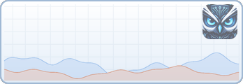
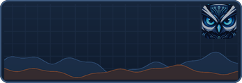
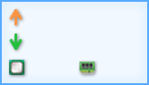

**[Tiếng Việt](./KhoGiaoDien.md) | English** · [Home](./README_en-us.md) · [FAQ](./Help_en-us.md) · [Skin making-up tutorial](./SkinTutorial_en-us.md)

# Skin gallery - tsudev-trafficmonitor

This page opens from the **Download more skins** link in the **Change Skin** dialog (when the interface language is not Vietnamese).

## Skins included in every release

Every tsudev-trafficmonitor release ships the skins below in the `skins` folder next to `tsudev-trafficmonitor.exe`. The images are the backgrounds used when **Show More Info** is on (`background_l`); text and numbers are drawn by the program at run time.

| Folder name | Background | Notes |
|---|---|---|
| `0_tsudev_Cu` |  | **Default skin** - tsudev owl, light background |
| `tsudev_Logo` |  | tsudev-trafficmonitor logo, black background |
| `tsudev_VongMang` |  | tsudev logo, dark background |
| `tsudev_DoThi_Sang` |  | Network graph, light background; also shows GPU and disk (`skin.xml`) |
| `tsudev_DoThi_Toi` |  | Network graph, dark background; also shows GPU and disk (`skin.xml`) |
| `GiaoDien03` |  | Dark background |
| `GiaoDien05` |  | |
| `GiaoDien06` |  | Dark background |
| `GiaoDien08` |  | Dark background |
| `GiaoDien09` |  | |
| `GiaoDien10` |  | Compact, icon style |
| `GiaoDien10_Doc` |  | Vertical |
| `GiaoDien11` |  | Coloured CPU/RAM tiles |

`0_tsudev_Cu`, `tsudev_Logo`, `tsudev_VongMang`, `tsudev_DoThi_Sang` and `tsudev_DoThi_Toi` are designed by tsudev (source images and generator scripts in `tools/skin_assets/`: `make_skins.py`, `make_skins_dothi.py`). The `GiaoDien*` skins come from the original TrafficMonitor project (see [NOTICE.md](./NOTICE.md)). Since V1.90-vn, four skins featuring third-party cartoon characters (`0_MacDinh`, `MacDinh2`, `GiaoDien01`, `GiaoDien02`) are no longer included; computers using them switch to `0_tsudev_Cu` automatically.

## Installing more skins

1. Each skin is **a folder** containing `skin.xml` or `skin.ini` plus the background images `background.bmp`/`background.png` (normal window) and `background_l.bmp`/`background_l.png` (when **Show More Info** is on).
2. Copy the whole skin folder into the `skins` folder next to `tsudev-trafficmonitor.exe`.
3. Right-click menu → **Other Functions** → **Change Skin...**, select the new skin and click **OK**.

> ⚠️ A skin contains only images and plain-text configuration files, never executable code. Still, only download skins from sources you trust, and never run `.exe`/`.bat` files bundled with a skin package.

## Making your own skin

See the [Skin making-up tutorial](./SkinTutorial_en-us.md): layout, item coordinates, text colours, transparent PNG backgrounds and how to test.

## Contributing a skin

Have a skin to share? Open an [issue](https://github.com/tsudev-org/tsudev-trafficmonitor/issues) or a pull request adding the skin folder to `tsudev-trafficmonitor/skins`, with:

* background images you designed yourself or have the right to redistribute (no third-party logos, characters or copyrighted artwork);
* your name in `skin_author` of the configuration file;
* agreement to release it under the project licence ([LICENSE](./LICENSE)).
